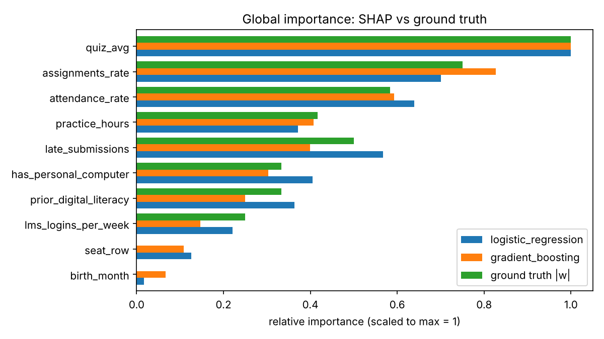
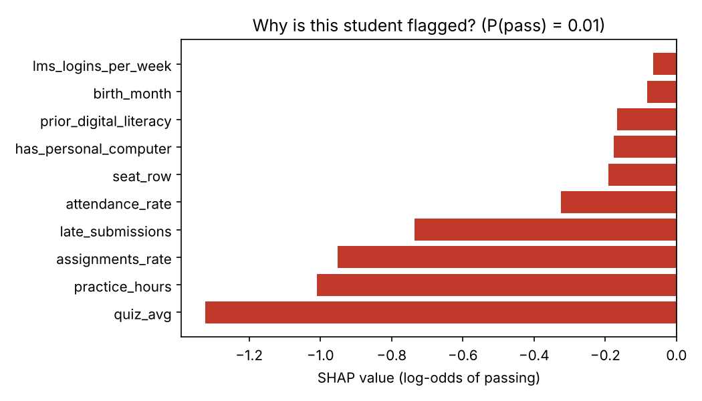

# Explainable Student-Performance Prediction

Early-warning models can tell a teacher which students are likely to fail a course, but a risk score alone is not enough: a teacher needs to know **why** a student was flagged in order to help. This project trains student-performance models and explains every prediction with **SHAP**, then checks whether those explanations are actually correct.

## The idea: test explanations against a known truth

Real student records are private and their true causes are unknown, so you can never check whether an explanation is right. This project therefore **simulates** a large introductory ICT course where the data-generating process is known (see `esp/data.py`):

| Feature | True effect on passing (log-odds per SD) |
|---|---|
| quiz_avg | +1.2 |
| assignments_rate | +0.9 |
| attendance_rate | +0.7 |
| late_submissions | −0.6 |
| practice_hours | +0.5 |
| prior_digital_literacy | +0.4 |
| has_personal_computer | +0.4 |
| lms_logins_per_week | +0.3 |
| seat_row, birth_month | **0 (irrelevant by design)** |

The features are also correlated through a hidden "engagement" variable, as in a real class. We can then ask: do the models recover the right drivers, and do they ignore the two irrelevant features?

> All data in this repository is synthetic. No real student data is included.

## Results (2,000 simulated students, pass rate 47%)

**Predictive performance** (5-fold cross-validation):

| Model | ROC-AUC | Accuracy | F1 |
|---|---|---|---|
| Logistic regression | **0.920 ± 0.006** | 0.842 ± 0.013 | 0.833 ± 0.015 |
| Gradient boosting | 0.912 ± 0.009 | 0.828 ± 0.012 | 0.819 ± 0.012 |

**Do the explanations match the truth?** Spearman correlation between mean |SHAP| and the true |weights| (held-out 25%):

| Model | Spearman ρ vs truth | Rank of seat_row / birth_month (out of 10) |
|---|---|---|
| Logistic regression | **0.976** | 9 / 10 |
| Gradient boosting | **0.982** | 9 / 10 |



**A local explanation.** The student the gradient-boosting model was most worried about (P(pass) = 0.005) had a quiz average of 26, submitted 29% of assignments, had 4 late submissions and 0.5 practice hours a week. SHAP attributes the risk mainly to the quiz average (−1.32), practice hours (−1.01), assignment rate (−0.95) and late submissions (−0.74):



### What I learned

* Both models recover the true ranking of causes very closely (ρ ≈ 0.98), and both rank the two irrelevant features last.
* **But irrelevant features still get non-zero credit.** For the flagged student, `seat_row` receives −0.19 log-odds, more than `prior_digital_literacy`, a real cause. Explanations of a single student can contain noise, so a teacher should read them as hints, not facts.
* The simple, interpretable logistic regression is slightly *more* accurate here than gradient boosting, a reminder that complex models are not automatically better on small tabular data.

## Reproduce

```bash
pip install -r requirements.txt
python scripts/run_study.py          # synthetic course, ~30 s
pytest -q
```

### Use your own (anonymised) data

Any CSV with numeric feature columns and a 0/1 outcome column works:

```bash
python scripts/run_study.py --csv my_class.csv --target passed
```

Only use data you are permitted to analyse, and remove names, IDs and other identifying information first.

## Layout

```
esp/data.py        synthetic course with known ground-truth weights
esp/model.py       models, cross-validation, SHAP, agreement metric
scripts/run_study.py
tests/             simulation checks, SHAP recovery, SHAP additivity
results/           cross_validation.csv, report.json, figures
```

## Next steps

* Track students week by week and predict risk early in the semester, not only at the end.
* Compare SHAP with LIME and permutation importance on the same students (see my `xai-comparison-toolkit`).
* Add a fairness check: does the model flag students without a personal computer more often than their performance justifies?

## References

* S. M. Lundberg, S.-I. Lee. *A Unified Approach to Interpreting Model Predictions.* NeurIPS 2017.
* C. Romero, S. Ventura. *Educational data mining and learning analytics: An updated survey.* WIREs Data Mining and Knowledge Discovery, 2020.

## Author

**Kazi Rezwan Rashid**, Lecturer in Computer Science and Engineering, Siddheswari University College, Dhaka.
[LinkedIn](https://www.linkedin.com/in/rezwan.rashid) · [Website](https://rezwanrashid.pythonanywhere.com/)

Licensed under the MIT License.
